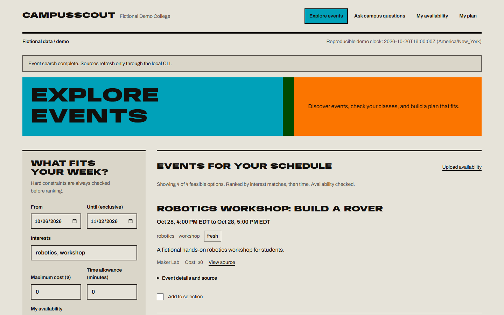
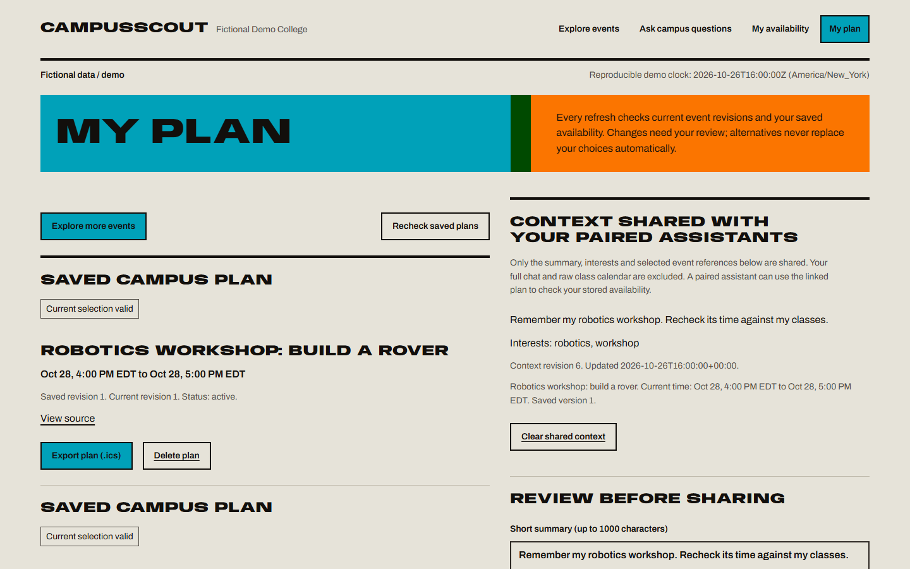

<div align="center">

<h1>CampusScout</h1>
<p><strong>Find campus events that fit your week.</strong></p>
<p>Discover a workshop, check your classes, and pick up your plan in another assistant.</p>

<p>
  <a href="#quick-start">Run locally</a> &nbsp; / &nbsp;
  <a href="#try-the-workshop-demo">Try the demo</a> &nbsp; / &nbsp;
  <a href="docs/HANDOFF_NOVEMBER_7.md">Hướng dẫn tiếng Việt</a> &nbsp; / &nbsp;
  <a href="#documentation">Documentation</a>
</p>

<p><code>Python 3.11–3.13</code> <code>Flask + SQLite</code> <code>MCP stdio</code></p>

</div>

[](docs/screenshots/overprint-events.png)

<p align="center"><sub>The CampusScout web app in this CampusAssistant repository. Click the screenshot to enlarge.</sub></p>

> **Start with the local demo.** The included campus, events, and documents are fictional. No university account, API key, or large model download is needed. Setup needs internet once; the default demo then runs offline.

## Why CampusScout?

Finding an interesting workshop is only half the task. You also need to know whether it fits your classes, whether its time has changed, and what you decided last time.

| What you want to do | How CampusScout helps |
| --- | --- |
| Find something relevant | Rank events by interests; check dates, budget, and uploaded availability. |
| Keep a plan you can trust | Save reviewed selections, check the latest event details, and catch new conflicts before exporting. |
| Continue in another assistant | Approve a short summary, interests, and selected events. A paired assistant can retrieve them without a copied plan code. |
| Check where an answer came from | Search campus document excerpts with page references and source links. |

Scheduling checks use Python rules. When an event changes, alternatives are suggestions for you to review; your saved choice is never replaced automatically.

## Quick start

Use **Python 3.12** (3.11–3.13 are supported), Git to clone the project, and a browser. Chrome was used for the local UI checks.

### Windows PowerShell

Use one PowerShell window for these commands. You do not need to activate the virtual environment.

**1. Get the project.** Already have this repo? Open its folder and skip this step.

```powershell
git clone https://github.com/DTran228/CampusAssistant.git
cd CampusAssistant
```

**2. Install the dependencies.** If `.venv` already exists, skip its creation.

```powershell
py -3.12 -m venv .venv
.\.venv\Scripts\python.exe -m pip install -r requirements-lock.txt
```

**3. Load the demo and start the app.**

```powershell
$env:CAMPUS_DATA_DIR=(Join-Path $PWD 'runtime/demo')
$env:CAMPUS_NOW='2026-10-26T12:00:00-04:00'
.\.venv\Scripts\python.exe -m campus_assistant.cli demo-handoff
.\.venv\Scripts\python.exe -m campus_assistant.cli serve
```

**4. Open [http://127.0.0.1:5555](http://127.0.0.1:5555) in Chrome.** Keep PowerShell open while using the app. Press **Ctrl+C** there to stop it.

The demo clock intentionally stays on **October 26, 2026**, so its sample events remain visible. The app does not load `.env` automatically; the shell commands above set the values it needs.

<details>
<summary><strong>Already installed? Start it again</strong></summary>

From the project folder, set the same data directory and demo clock, then start the server:

```powershell
$env:CAMPUS_DATA_DIR=(Join-Path $PWD 'runtime/demo')
$env:CAMPUS_NOW='2026-10-26T12:00:00-04:00'
.\.venv\Scripts\python.exe -m campus_assistant.cli serve
```

Your saved plans remain in that data directory. Run `demo-handoff` again only when you want to restore the fixture event contents; it preserves plans and revision history, so older selections still need review.

</details>

<details>
<summary><strong>macOS / Linux setup</strong></summary>

After cloning the repo and opening its folder:

```sh
python3.12 -m venv .venv
.venv/bin/python -m pip install -r requirements-lock.txt
export CAMPUS_DATA_DIR="$PWD/runtime/demo"
export CAMPUS_NOW='2026-10-26T12:00:00-04:00'
.venv/bin/python -m campus_assistant.cli demo-handoff
.venv/bin/python -m campus_assistant.cli serve
```

Open the same localhost address. These commands and a Windows/Linux CI workflow are supplied; the recorded local runs were on Windows.

</details>

## Try the workshop demo

Follow this path in the browser after starting the app:

| Step | What to do |
| --- | --- |
| **1. Add your classes** | In **My availability**, upload [`data/demo/classes.ics`](data/demo/classes.ics). Choose **Oct 26–Nov 2, 2026** and `America/New_York`. |
| **2. Find a workshop** | In **Explore events**, use the same dates, interests `robotics, workshop`, cost `0`, and the availability you just uploaded. Click **Find events**. |
| **3. Save your choice** | Select **Robotics workshop: build a rover**, then **Save to my plan**. Its original time is Wednesday, Oct 28, **16:00–17:00 EDT**. |
| **4. Choose what to remember** | Open **My plan**. Write a short summary, review the interests and selected plan, tick the confirmation checkbox, then **Save approved context**. |

To download a calendar file, use **Export plan (.ics)** and import it into your calendar yourself. Export does not register attendance or modify an external calendar.

### What if the organizer changes the time?

Open a **second PowerShell window in the project folder** and run:

```powershell
$env:CAMPUS_DATA_DIR=(Join-Path $PWD 'runtime/demo')
$env:CAMPUS_NOW='2026-10-26T12:00:00-04:00'
.\.venv\Scripts\python.exe -m campus_assistant.cli demo-change --workshop
```

Refresh **My plan**:

| Before the update | After the update |
| --- | --- |
| Workshop: Wed Oct 28, **16:00–17:00 EDT** | Workshop: Tue Oct 27, **14:15–15:15 EDT** |
| Fits the sample class schedule | Overlaps a class running **14:00–15:30** |
| Reviewed selection can be exported | Export is blocked until you review a valid selection |

The **sensors lab** on Thursday, Oct 29, **16:00–17:00 EDT**, is offered as an alternative. You decide whether to choose it. The original plan remains intact.

<details>
<summary><strong>See the saved-plan and shared-context screen</strong></summary>

[](docs/screenshots/overprint-plan.png)

This is the web review screen with fictional records. [View the mobile layout](docs/screenshots/overprint-mobile.png).

</details>

Want to try document search too? In **Ask campus questions**, ask: **“How long can I reserve a group study room?”** Inspect the fictional library excerpt and page reference.

## Continue in another assistant

MCP is the interface that lets a compatible assistant call the same local planner used by the website.

1. Assistant A helps you choose a workshop and saves only the context you approve.
2. A closes. Assistant B starts with the **same local profile and data directory**.
3. B retrieves the context without a copied plan ID, checks the latest event time, and explains any conflict.

Try the standalone demonstration from the project folder:

```powershell
.\.venv\Scripts\python.exe -m eval.handoff_demo
```

Read each preview and type `yes` to approve. The demo starts independent official-SDK MCP clients, closes A, changes the workshop, and starts B. It uses a separate temporary database; it does not open two desktop chat apps.

To connect an actual host or share the web session's profile, follow [MCP setup and one-time pairing](docs/MCP_SETUP.md). A specific desktop host remains a separate validation step.

## Your data, your choice

- **Local storage:** imported availability and saved plans live in SQLite under your chosen data directory. Raw calendar bytes and class titles are discarded after import.
- **Explicit sharing:** you review the short summary, interests, and selected plan before a paired assistant can resume that context. Full chats and raw calendars are excluded from shared context.
- **Separate profiles:** another profile cannot read or overwrite your private plan. This is a local profile boundary, not a public account/login system.
- **Clear when you want:** **Clear shared context** leaves the original plans and availability in place. It cannot retract copies already received by an assistant host.

Sources refresh when explicitly requested. CampusScout does not provide automatic event monitoring, registration, or university-system access.

## Questions and fixes

| Problem | What to check |
| --- | --- |
| **No events appear** | Set `CAMPUS_NOW` to the demo clock before starting the server. Use Oct 26–Nov 2, 2026. Load fixtures with `demo-handoff`. |
| **Chrome cannot open the app** | Keep the server terminal running. Use `http://127.0.0.1:5555`. If the port is busy, run `serve --port 5556` and open port `5556` instead. |
| **The old design still appears** | Refresh Chrome with **Ctrl+Shift+R**. |
| **My saved plan seems missing** | Reuse the same data directory and browser session. A different browser profile or cleared session cookie starts a separate web profile. |
| **Export is blocked** | Open **My plan** and review source changes, conflicts, or source freshness. Recheck before selecting/exporting a current valid option. |
| **`py` is not found** | Install Python 3.12 from [python.org](https://www.python.org/downloads/), reopen PowerShell, and retry. If you already have Python, use its full executable path to create `.venv`. |

## For developers

The app is **Flask + SQLite + Jinja + vanilla JavaScript**. Web handlers and the stdio MCP server call shared Python services. The default document search is a clearly labeled lexical demo; MPNet/FAISS and local LLM generation are optional.

Run the offline checks from the repo root:

```powershell
.\.venv\Scripts\python.exe -m pytest -q -m 'not real_retrieval'
.\.venv\Scripts\python.exe -m eval.run
```

Recorded Windows checks: **75 offline tests passed**, with one optional real-model test deselected. The 36 planner fixtures had no incorrect feasible recommendations or missed valid options. These are software checks on fictional data; student time savings and other user-study outcomes remain **unmeasured**. See [verification evidence](eval/results/overprint-verification.json) and [evaluation methodology](docs/EVALUATION.md).

For configuration, source import, model setup, API routes, and clean demo resets, use the [developer guide](docs/DEVELOPMENT.md).

## Documentation

| Looking for… | Start here |
| --- | --- |
| A Windows walkthrough in Vietnamese | [Demo and A → B handoff](docs/HANDOFF_NOVEMBER_7.md) |
| MCP tools, profiles, and client configuration | [MCP setup](docs/MCP_SETUP.md) |
| Configuration, imports, optional models, and API | [Developer guide](docs/DEVELOPMENT.md) |
| Scheduling logic and tradeoffs | [Architecture](docs/ARCHITECTURE.md) |
| The Overprint frontend and shared tokens | [Frontend design](docs/FRONTEND_DESIGN.md) / [design system](design.md) |
| Test methodology and future student research | [Evaluation](docs/EVALUATION.md) / [study protocol](docs/STUDY_PROTOCOL.md) |
| Ownership, sources, and licensing notes | [Provenance](docs/PROVENANCE.md) / [contributions](docs/CONTRIBUTIONS.md) |
| Implementation claims and their evidence | [Resume evidence](docs/RESUME_EVIDENCE.md) |

<sub>README presentation inspired by [Kites](https://github.com/Unheat/Kites). Screenshots, examples, and product descriptions here belong to CampusAssistant.</sub>
